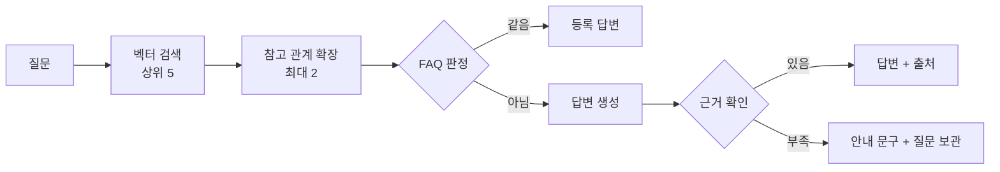

## 프로젝트 개요

제 프로필·프로젝트·블로그를 하나의 문서 계층으로 묶고, 방문자가 "NestJS를 쓴 프로젝트가 있나요?"처럼 물으면 공개된 문서만 근거로 답하는 RAG 챗봇을 붙인 개인 포트폴리오입니다. 프로젝트와 블로그 글이 서로 어떻게 이어지는지는 그래프로 보여 줍니다.

혼자 진행하는 사이드 프로젝트로, 기획·설계·백엔드·프론트엔드·RAG 측정을 모두 맡았습니다. 백엔드는 Spring Boot를 배우면서 만들었고, 개발은 Claude Code·Codex와 문서 기반으로 협업했습니다. 설계 결정은 ADR로 남기고 측정은 실제 모델로 직접 실행했습니다. 월 운영비 10만 원(서버·DB·API·도메인 포함) 안에서 운영하도록 설계했습니다.

| 항목 | 내용 |
|---|---|
| 팀 구성 | 1명(본인), AI 에이전트(Claude Code·Codex) 협업 |
| 나의 역할 | 기획·설계, 백엔드·프론트엔드 개발, RAG 측정과 결정, AI 협업 규칙 운영 |

## 학습 내용

- **Spring Boot 생태계에 대한 이해:** 백엔드를 Spring Boot로 만들면서 JPA·QueryDSL로 데이터 접근을, Flyway로 스키마 변경 이력을, Spring AI로 모델 호출을 다뤘습니다. 관리자 화면은 GitHub OAuth로 본인 계정만 들어올 수 있게 했고, 백엔드 테스트 120건을 작성했습니다.
- **RAG 서비스에 대한 이해:** 프로젝트·블로그·프로필·FAQ를 공통 문서로 묶어 색인하고, 섹션 단위로 청킹해 pgvector로 근거를 찾는 흐름을 만들었습니다. 청킹 규칙과 근거 판정 방식은 설계 때 세운 가정 대신 측정 결과를 보고 정했고, 샘플 질문 7개에서 기대 출처를 모두 찾았습니다.
- **채팅 서비스 구현:** 답변은 SSE로 처리 상태, 참고 문서, 답변 조각을 차례로 보냈습니다. 방문자 로그인 없이 서버가 발급한 식별 값과 비밀키로 대화를 나눴고, 대화는 마지막 활동 후 24시간이 지나면 지우며 모델에는 최근 3턴만 보냈습니다. 비용은 IP당 하루 20개, 전체 300개 질문 제한으로 묶었습니다.

## RAG 설계

공개 콘텐츠를 공통 문서로 바꿔 벡터 색인하고, 질문마다 벡터 검색 → 참고 관계 1단계 확장 → FAQ 판정 → 답변 생성 순서로 처리합니다. 근거가 없으면 답을 지어내지 않고 질문을 보관해 두었다가 제가 FAQ나 본문으로 채웁니다. 별도 Python 서비스 없이 Spring Boot 하나가 전체 흐름을 맡고, 원본·문서·벡터·대화를 PostgreSQL 한 곳에 둡니다.

```text
[색인]  콘텐츠 저장 → 공통 문서로 변환 → "## " 섹션 단위 청킹 → 임베딩 → pgvector
[검색]  질문(+직전 질문) → 공개 청크 상위 5개 → 참고 관계로 이어진 문서 최대 2개 추가
[판단]  근거에 FAQ가 있으면 같은 질문인지 판정 → 같으면 등록한 답변을 그대로 보냄
[생성]  근거 안의 내용만으로 답하고 [1]처럼 번호로 인용 → 근거가 없으면 안내 문구
[보강]  답하지 못한 질문 보관 → FAQ 등록·본문 보강 → 다시 색인
```



### 색인

- 프로젝트·블로그·프로필·FAQ는 형태가 서로 다르지만, 저장하면 같은 트랜잭션에서 공통 문서 한 행으로 바뀝니다. 경력 성과는 프로필 문서 안의 섹션 하나가 되어, 성과 하나가 검색 단위 하나가 됩니다.
- 임베딩은 커밋 뒤 비동기로 호출해서, OpenAI가 느리거나 실패해도 관리자 저장은 막히지 않습니다. 색인하는 사이에 글이 다시 고쳐지면 내용 해시를 비교해 다음 실행으로 넘깁니다.
- `## ` 제목으로 섹션을 나누고, 200자 미만 조각은 앞 청크에 붙입니다. 1200자를 넘는 섹션만 빈 줄 기준으로 다시 나눕니다.

### 검색

- pgvector 코사인 거리로 상위 5개 청크를 찾습니다. 공개 여부와 카테고리별 채팅 반영 여부는 검색할 때 거르기 때문에, 글을 비공개로 바꾸면 재색인 없이 바로 검색에서 빠집니다.
- 글을 쓸 때 고른 참고 문서를 간선으로 보고, 검색된 문서에서 한 단계만 따라가 최대 2개 문서의 가장 가까운 청크를 근거에 더합니다.
- "거기서 맡은 역할은?" 같은 후속 질문은 직전 질문을 검색어 앞에 붙여 찾습니다. 질문을 다시 쓰는 모델 호출은 따로 두지 않았습니다.

### 판단과 생성

- 판단용 모델은 따로 두지 않고 gpt-4.1-mini가 두 번 판단합니다. 근거에 FAQ가 있으면 먼저 같은 질문인지 번호 하나로만 답하게 하고, 아니면 답변을 만들면서 근거로 답할 수 없을 때 맨 앞에 표시를 붙이게 했습니다.
- 표시가 있거나 인용 번호가 하나도 없으면 답하지 못한 질문으로 봅니다. 표시는 스트림에서 지우고 안내 문구를 보냅니다.
- 출처는 답변에 실제로 나온 번호를 문서 단위로 모아 보여 줍니다. 측정해 보니 문장 단위 인용이 느슨해서 문서 단위로 정했습니다.

### 보강

- 답하지 못한 질문은 당시 검색된 문서·거리와 함께 90일, 정상 답변은 7일 보관합니다. 방문자 IP 같은 식별 정보는 저장하지 않습니다.
- 관리자 화면에서 질문을 FAQ로 등록하면 FAQ도 문서로 색인되어, 다음에 같은 뜻의 질문이 오면 등록한 답변이 나갑니다.

## 주요 화면

### 홈

방문자가 바로 질문할 수 있는 입력창과 추천 질문, 프로젝트·블로그·소개로 가는 카드를 첫 화면에 두었습니다.

### RAG 채팅

공개 문서만 근거로 답하고, 답변 아래에 근거 문서를 프로젝트·블로그 단위로 표시합니다. 대화는 왼쪽 목록에 남고, 마지막 질문 후 24시간 뒤 삭제됩니다.

### 프로젝트 목록과 상세

대표 작업을 먼저 보여 주고, 각 프로젝트에 기간·역할·주요 작업·기술을 표시합니다.

상세 하단에는 이 프로젝트가 참고하는 블로그 글을 연결하고, 그래프에서 연결 관계를 바로 볼 수 있게 했습니다.

### 블로그

카테고리별로 글을 모아 보고, 글마다 요약과 태그를 표시합니다.

### 문서 관계 그래프

프로젝트·블로그·카테고리·스킬을 노드로 두고, 참고 관계와 사용 기술, 카테고리 소속을 간선으로 이었습니다. 왼쪽 위에서 종류별로 노드를 끄거나 검색할 수 있습니다.

프로젝트 상세의 "이 프로젝트의 연결 보기"로 들어오면 해당 노드가 선택된 상태로 열리고, 오른쪽에 연결된 글과 기술이 표시됩니다.

## 배운 점

### Spring Boot 생태계에 대한 이해

프론트엔드에서는 요청이 실패하면 화면에 오류를 보여 주면 됐지만, 서버에서는 어디까지를 한 트랜잭션으로 묶을지부터 정해야 했습니다. 임베딩 API가 느려지면 관리자 저장까지 같이 멈출 수 있어서, 문서 변환까지만 트랜잭션에 넣고 임베딩은 커밋 뒤 비동기로 돌렸습니다. 데이터 접근 도구도 하나로 통일하지 않았습니다. 업무 데이터는 JPA·QueryDSL로, pgvector 검색처럼 SQL이 그대로 보이는 편이 나은 곳은 JdbcTemplate으로 썼습니다. 스키마 변경은 Flyway 마이그레이션으로 남겨, 어떤 결정 때문에 어떤 열이 생겼는지 나중에 되짚을 수 있었습니다.

### RAG 서비스에 대한 이해

설계할 때 세운 가정 세 가지가 모두 측정에서 틀렸습니다. 섹션이 길어서 나눠야 한다는 가정, 유사도로 근거 유무를 가를 수 있다는 가정, 임베딩 거리로 같은 뜻을 가를 수 있다는 가정이었습니다. 그때마다 측정 결과를 보고 설계를 고쳤고, 그 뒤로는 표본이 작아도 먼저 재 본 다음 정했습니다. 근거가 없을 때 다시 검색해도 새 근거는 생기지 않기 때문에, 자동 재검색 대신 질문을 보관해 두고 제가 콘텐츠를 채우는 방식을 택했습니다.

### 채팅 서비스 구현

SSE는 서버, 중간 프록시, 브라우저를 모두 맞춰야 동작했습니다. 프록시가 응답을 모아서 보내지 않도록 버퍼링을 끄는 헤더를 넣었고, 브라우저 기본 `EventSource`로는 POST와 헤더를 보낼 수 없어 `fetch`로 받아 직접 파싱했습니다. 조각 경계에서 한글이 잘릴 수 있어 디코더를 스트림 모드로 썼고, 근거 부족 표시도 두 조각에 나뉘어 올 수 있어 표시 길이만큼 출력을 늦춰 지웠습니다. 로그인 없는 대화에서는 세션이 없을 때, 만료됐을 때, 비밀키가 틀렸을 때 모두 같은 404로 답해 세션이 있는지조차 드러나지 않게 했습니다. 근거가 없는 질문에도 모델 호출은 일어나므로, 질문 제한이 곧 비용 상한 역할을 합니다.
